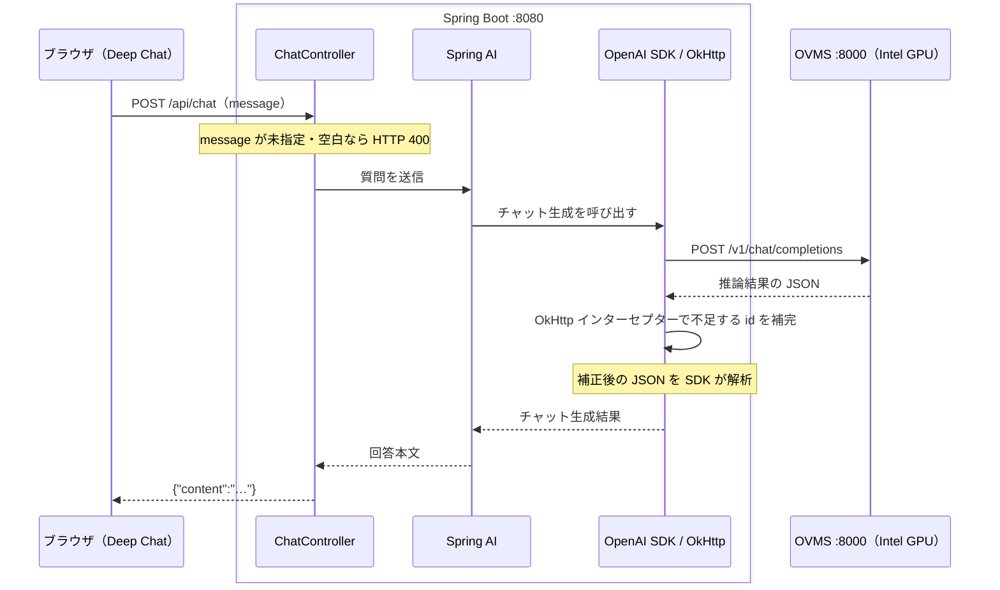

# spring-ai-local-llm-chat

Spring AI ChatClient から OpenVINO Model Server（OVMS）を呼び出すサンプルです。

## 構成

Spring Boot と Docker Compose で起動する OVMS を、同じ Ubuntu（WSL2）上で動かします。推論は OVMS が Intel GPU を使って実行します。



Spring AI の OpenAI 用クライアントから、OVMS の OpenAI 互換 API を呼び出します。質問ごとに回答本文を返し、会話履歴は保持しません。

| ファイル | 役割 |
| --- | --- |
| `static/index.html` / `chat.js` | Deep Chat の画面と API への接続 |
| `ChatController.java` | message の未指定・空白チェックと、Spring AI を使った回答の取得 |
| `OvmsCompatibilityConfiguration.java` | OVMS 応答の不足する `id` を補完 |
| `application.properties` | OVMS の接続先・モデル名を設定 |
| `compose.yaml` | OVMS の起動とモデル・GPU の設定 |

### プロキシと応答補正

OVMS のチャット応答では `id` が省略されることがあります。OpenAI SDK が期待する形式に合わせるため、`OvmsCompatibilityConfiguration` で不足する `id` を生成して追加します。これにより、ID の欠落による回答の読み取りエラーを防ぎます。

## 環境

- Ubuntu（WSL2）
- Intel GPU と対応ドライバー
- Docker Compose
- JDK 21 以上

## 1. OVMS を起動する

プロジェクトのルートで実行します。

```bash
ls -l /dev/dxg
ls -ld /usr/lib/wsl

# .envにコンテナ実行用のUID/GIDを設定（ホストユーザーに合わせる)
echo "LOCAL_UID=$(id -u)" > .env
echo "LOCAL_GID=$(id -g)" >> .env

mkdir -p models
docker compose up -d
docker compose logs -f ovms
```

初回はモデルのダウンロードとロードに時間がかかります。
モデルは `models/` に保存されます。ログ表示は Ctrl+C で終了できます。

ロード完了後に確認します。

```bash
curl --fail-with-body -sS http://127.0.0.1:8000/v1/models
```

モデル名 `gemma4-e4b` が表示されることを確認してください。

## 2. Spring Boot を起動する

同じ Ubuntu（WSL2）で実行します。

```bash
bash ./mvnw spring-boot:run
```

接続設定は `src/main/resources/application.properties` に記載します。

```properties
spring.ai.openai.api-key=dummy-key
spring.ai.openai.chat.base-url=${OVMS_BASE_URL:http://127.0.0.1:8000/v1}
spring.ai.openai.chat.model=${OVMS_MODEL:gemma4-e4b}
```

## 3. 質問する

ブラウザで http://localhost:8080/ を開き、質問を入力して送信します。Deep Chat を CDN（unpkg）から読み込むため、インターネット接続が必要です。

画面にやりとりは表示されますが、モデルに送るのは今回の質問だけです。再読み込みすると表示履歴は消えます。

### テスト用途の注意

この画面は **ローカルのテスト専用** です。本番利用・外部公開はしないでください。使用する Deep Chat 2.5.1 には XSS（CVE-2026-108852）の報告があります。機密情報は入力せず、回答内の不審なリンクは開かないでください。[公式 Issue](https://github.com/OvidijusParsiunas/deep-chat/issues/522)

## 停止・ログ確認

Spring Boot は Ctrl+C で停止します。

```bash
docker compose logs --tail=100 ovms
docker compose down
```

接続できない場合は OVMS のログを、HTTP 500 の場合は Spring Boot の例外ログを確認してください。